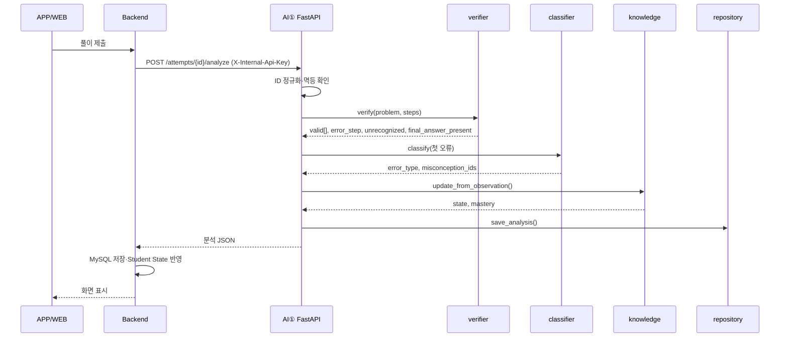
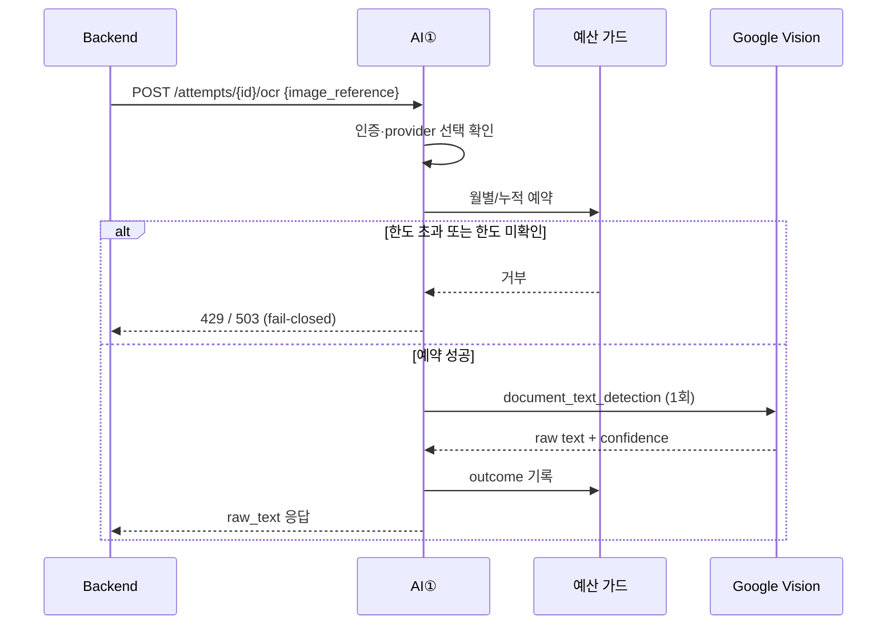
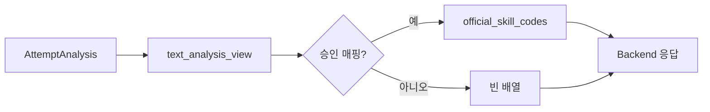

# AI① Learning Intelligence — 13주차 발표 대비 기술 분석 보고서

> 분석일: **2026-11-23** · 브랜치: **main** · HEAD: **9188f0c** (2026-11-17 12:27 +0900)
> 실행 환경: Windows, Python **3.12.10** (`.venv`)
> 검증: `pytest` **1904 passed** (약 4분), `pyflakes app tests eval` **0건**
> 주의: 워킹트리에 **미커밋 변경 35개 경로**(수정 28 / 신규 7)가 있다. 아래에서
> "현재 코드"는 워킹트리, "HEAD"는 `9188f0c`를 뜻한다.
> 갱신(2026-11-23): HEAD `3eebc1d`(clean) 기준 **분기 답안 판정 보완** 반영 —
> `review_reasons` 추가, `tests/test_final_answer_present.py` 26건, pytest **1904 passed**.
> 아래 §0.2·§4.12·§9 상태표에 반영했다.

## 목차

0. [분석 기준과 문서-코드 차이](#0-분석-기준과-문서-코드-차이)
1. [파트 개요](#1-파트-개요)
2. [기술 스택 및 라이브러리](#2-기술-스택-및-라이브러리)
3. [프로젝트 구조](#3-프로젝트-구조)
4. [구현 기능 상세](#4-구현-기능-상세)
5. [데이터베이스 및 데이터 구조](#5-데이터베이스-및-데이터-구조)
6. [API 및 파트 간 연동](#6-api-및-파트-간-연동)
7. [핵심 실행 흐름](#7-핵심-실행-흐름)
8. [테스트 및 검증 결과](#8-테스트-및-검증-결과)
9. [현재 개발 진행 상황](#9-현재-개발-진행-상황)
10. [교수님 예상 질문 15개](#10-교수님-예상-질문-15개)
11. [타 파트 담당자를 위한 학습 자료](#11-타-파트-담당자를-위한-학습-자료)
12. [발표 자료 및 발표 대본](#12-발표-자료-및-발표-대본)
- [부록 A. 발표 전 체크리스트](#부록-a-발표-전에-반드시-할-일)
- [부록 B. 재현 명령](#부록-b-재현-명령)

---

## 0. 분석 기준과 문서-코드 차이

### 0.1 미커밋 변경 (HEAD에 없음)

| 그룹 | 주요 파일 | 상태 |
|---|---|---|
| OCR 예산 가드 | `app/integration/google_vision_budget.py`, `google_vision.py`, `eval/*`, `tests/test_google_vision_budget.py`, `scripts/ocr_usage_status.py` | 구현·테스트 완료, 미커밋 |
| 응답 필드 | `app/pipeline/verifier.py`, `session.py`, `schemas.py`, `main.py`, `tests/test_final_answer_present.py` | 구현·테스트 완료, 미커밋·미배포 |
| 문서 | `docs/AI1_A3_*.csv`, `docs/AI1_AI2_*.txt` | 산출물, 미커밋 |

### 0.2 이전 보고서와 실제 코드의 차이 (표시)

| 문서 | 문서 기재 | 실제 (2026-11-23) |
|---|---|---|
| `README.md` §검증 현황 | pytest **1713 passed** | **1904 passed** |
| `README.md` §검증 현황 | 271 → 1713 | 1904 (기준선 증가) |
| `docs/AI1_명세서_대조표.md` 머리말 | 2026-11-08 실행, **1713 passed** | 1904 passed |
| `docs/AI1_HANDOFF.md` Phase 9-9C.4 | 1602 tests | 1904 passed |
| `docs/AI1_openapi.json` | 8개 경로 포함 | 맞음. 단 `final_answer_present`·`review_reasons` **없음** (스냅샷이 두 필드 뒤처짐) |
| `README.md` §알려진 한계 | `x^2=16 → x=4` 해 누락 한계 | 맞음. 다중 줄 답안(`x=3`/`x=-3`)은 **REVIEW_REQUIRED + `review_reasons`** 로 처리하도록 보완됨(2026-11-23) |

> 발표에서는 "문서의 1713은 과거 스냅샷이고, 현재 1904"라고 설명하면 된다.

---

## 1. 파트 개요

### 1.1 담당 파트와 핵심 역할
AI① **Learning Intelligence**. 학생의 풀이 **과정**을 읽고
① 최초 오류 단계 ② 오류 유형 ③ 오개념 ④ Skill별 Knowledge State를 만든다.

- 정답·힌트·설명 생성은 하지 않는다 (AI② 담당, ADR-01).
- 오개념은 taxonomy 조회로만 붙인다. 자유 생성 금지 (ADR-02).
- 인식 실패·판정 불가는 오답이 아니라 `unrecognized`/`REVIEW_REQUIRED`로 분리한다 (ADR-03).

### 1.2 전체 시스템에서의 위치
```
APP/WEB → Backend(FastAPI, MySQL) → AI①(이 파트, FastAPI)
                                  → AI②(튜터 액션)
```
- AI①은 **DB를 직접 쓰지 않는다.** Backend가 MySQL을 소유하고, AI①은 HTTP JSON으로
  분석 결과를 돌려준다. 현재 저장은 **in-memory**다.
- AI②는 AI①의 `observations[]`를 관측 출처로 쓴다. 공통 코드 변환은 Backend 경계 몫이다.

### 1.3 주고받는 데이터
| 방향 | 데이터 |
|---|---|
| 입력 | `attempt_id`, `problem_latex`, `problem_skills`, `solution_text`, `correct_solution`(선택), `problem_type`/`target_form`, `engine`, (OCR) `image_reference` |
| 출력 | `correct`, `error_step`, `error_type`, `skill`, `state`, `mastery`, `steps_latex`, `valid`, `unrecognized`, `step_list`, `errors[]`, `observations[]`, `analysis_status`, `official_*`/`provisional_*`, `final_answer_present`, `review_reasons`(판정 보류 사유, 정상 `[]`) |

### 1.4 현재 범위와 최종 목표
- **현재**: 텍스트 풀이. 중학 일차방정식 중심 + 이차·다항식 일부. expression 모드(A6 P1).
  OCR은 **raw_text 미리보기**만. 이력 조회는 in-memory.
- **최종**: 이미지 입력 → 구조화 OCR → Skill/Concept 매핑 → MySQL 영속화 → BKT 파라미터 피팅.

---

## 2. 기술 스택 및 라이브러리

### 2.1 실제 의존성 (`requirements.txt` + 설치 버전)

| 기술 | 버전 | 목적 | 실제 사용 | 근거 위치 |
|---|---|---|---|---|
| Python | 3.12.10 | 런타임 | 전체 | `.venv` |
| FastAPI | 0.141.1 | HTTP API, 요청/응답 검증, OpenAPI | 9개 라우트 | `app/main.py` |
| Uvicorn | 0.54.0 | ASGI 서버 | 실행 명령 | `README.md` §실행 |
| Pydantic | 2.13.5 | 스키마·타입 검증 | `extra="forbid"` 요청, 응답 모델 | `app/schemas.py`, `app/pipeline/session.py` |
| SymPy | 1.14.0 | 수식 파싱·동치·해집합 | `parse_line`, `equivalent`, `solve` | `app/pipeline/parser.py`, `verifier.py` |
| google-cloud-vision | 3.16.0 | OCR (opt-in) | `document_text_detection` | `app/integration/google_vision.py` |
| pytest | 9.1.1 | 자동 테스트 | 1904건 | `tests/`, `eval/test_*.py` |
| httpx | 0.28.1 | 테스트 HTTP 클라이언트 | `TestClient` | `tests/*` |
| pyflakes | 4.0.0 | 정적 lint | 0건 유지 | CI 대체 로컬 검사 |
| Starlette | 1.7.0 | FastAPI 기반 | 간접 의존 | — |
| protobuf | 7.36.2 | Vision SDK 간접 의존 | 간접 | — |

- `requirements.txt`는 **하한선(`>=`)** 표기다. 정확한 고정 버전은 위 표(설치 환경) 기준.
- **DB 드라이버·ORM 없음**: `sqlalchemy`, `pymysql` 등이 의존성에 없다. DB는 Backend 소유.

### 2.2 핵심 라이브러리 5개 (비전공자 설명)

1. **FastAPI** — 파이썬 함수에 URL을 붙여 주는 웹 프레임워크. 요청 JSON이 스키마와 다르면
   자동으로 422를 돌려준다. 덕분에 "잘못된 입력을 분석 로직까지 보내지 않는" 경계가 생긴다.
2. **Pydantic** — 데이터의 모양을 코드로 선언하는 도구. `extra="forbid"`로 "모르는 필드"를
   거절해, 계약에 없는 값이 조용히 무시되는 사고를 막는다.
3. **SymPy** — 문자를 포함한 수식을 컴퓨터가 다룰 수 있게 하는 라이브러리.
   `2(x-3)=6`과 `2x-6=6`이 같은 식인지 기호적으로 비교한다.
4. **Google Cloud Vision** — 사진에서 글자를 읽는 OCR 서비스. AI①은 문제/풀이를 나누지
   않고 **원문 텍스트만** 받는다. 과금 보호를 위해 자체 예산 가드를 둔다.
5. **pytest + httpx** — 코드를 자동으로 실행해 기대값과 비교하는 도구. httpx의 `TestClient`로
   실제 HTTP 요청처럼 API를 호출해 검증한다.

---

## 3. 프로젝트 구조

```
learning-intelligence/
  app/
    main.py                 # FastAPI 앱, 9개 라우트, 응답 조립
    schemas.py              # 요청/응답 Pydantic 스키마
    taxonomy.py             # data/*.json 로더·검증
    pipeline/
      parser.py             # LaTeX→SymPy, 단계 분리
      verifier.py           # 단계별 동치 판정(Verdict), final_answer_present
      classifier.py         # 오류 유형·오개념 매핑
      knowledge.py          # Rule/BKT Knowledge State
      session.py            # Attempt 도메인 모델, analyze_attempt()
      analyzer.py           # legacy analyze() 엔트리
      repository.py         # in-memory 저장소(추상 인터페이스)
      forms.py              # expanded/factored/integer 형태 판정
      notation.py           # 함수 표기 차단
      inequality.py         # 부등식 차단
    integration/
      backend_adapter.py    # Backend 전달용 뷰(official/provisional)
      backend_crosswalk.py  # 승인 코드 매핑(2건)
      internal_auth.py      # X-Internal-Api-Key
      ocr.py                # OCR provider 경계·상태 파생
      google_vision.py      # Vision provider
      google_vision_budget.py # 누적+월별 호출 예산 가드
      host_policy.py        # 허용 호스트 파싱
      preflight.py          # 환경변수 오프라인 점검
  data/                     # skills / error_types / misconceptions (frozen)
  tests/                    # 1904건 (단위·API·계약·회귀)
  eval/                     # OCR 품질 측정 하네스(런타임 아님)
  scripts/                  # OCR 상태 조회, ngrok 터널 기동
  docs/                     # 대조표·계약서·회신·OpenAPI 스냅샷
```

### 3.1 시작 지점과 실행
- 앱 객체: `app/main.py`의 `app = FastAPI(...)`
- 실행: `.venv\Scripts\uvicorn app.main:app --reload`
  (Backend 연동 시 `--host 127.0.0.1 --port 8001`)
- 문서 노출: 기본 404. 로컬만 `AI1_ENABLE_DOCS=1`로 `/docs`·`/openapi.json` 활성.
- 터널: `scripts/start_ai1_tunnel.ps1` (ngrok 고정 도메인, 토큰은 저장소에 없음)

### 3.2 핵심 호출 관계
```
main.py
 ├─ analyzer.analyze()            (legacy /analyze-solution)
 └─ session.analyze_attempt()     (canonical /api/v1/attempts/{id}/analyze)
      ├─ parser.split_steps / parse_line
      ├─ verifier.verify / verify_expression
      ├─ classifier.classify
      ├─ knowledge.get_engine(...).update_from_observation
      └─ repository.save_analysis
main.py → integration.backend_adapter.text_analysis_view (official_* 코드)
main.py → integration.ocr / google_vision (OCR)
```

### 3.3 설정 관리
- `.env` 파일을 쓰지 않고 **OS 환경변수**를 매 요청 읽는다 (`internal_auth._configured_keys`).
- 비밀값은 응답·로그에 남기지 않는다. preflight는 값이 아니라 **변수 이름**만 보고한다.
- 주요 변수: `AI1_INTERNAL_API_KEYS`, `AI1_OCR_PROVIDER`, `GOOGLE_APPLICATION_CREDENTIALS`,
  `GOOGLE_VISION_TIMEOUT_SECONDS`, `AI1_OCR_ALLOWED_HOSTS`, `AI1_ENABLE_DOCS`,
  `AI1_OCR_BILLING_UNIT`, `AI1_OCR_MONTHLY_FREE_QUOTA`, `AI1_OCR_MONTHLY_CALL_CAP`,
  `AI1_OCR_FREE_QUOTA_CONFIRMED`.

---

## 4. 구현 기능 상세

### 4.1 legacy 텍스트 분석 — `POST /analyze-solution`
- **사용자 관점**: 문제식과 풀이 텍스트를 보내면 오류 단계·유형·오개념·상태를 받는다.
- **입력**: `problem_latex`, `solution_text`, `student_id`, `engine`, `problem_skill`,
  `problem_type`, `target_form`.
- **처리**: `analyzer.analyze()` →
  1) `split_steps()`로 단계 분리(줄바꿈/→)
  2) `parse_line()`로 SymPy 노드화. 실패 줄은 `unrecognized`
  3) `verify()`/`verify_expression()`로 단계별 동치 판정
  4) 첫 오류 줄에 `classify()` 적용
  5) `get_engine(engine).update_from_observation()`
  6) 응답 dict 조립 (`_review_payload` 또는 정상 페이로드)
- **출력**: 기존 11필드 + `skills`/`skill_ids`/`error_subtype`/`misconception_ids`.
- **라이브러리**: SymPy, Pydantic.
- **근거**: `app/pipeline/analyzer.py:228`, `verifier.py:400`, `classifier.py:285`.
- **상태**: 구현 완료 / 테스트 완료.
- **테스트**: `tests/test_api.py`, `test_golden_regression.py`, `test_answer_only_policy.py`.

### 4.2 canonical Attempt 분석 — `POST /api/v1/attempts/{attempt_id}/analyze`
- **사용자 관점**: 앱의 한 시도(재촬영 포함)를 회차 단위로 분석하고 이력을 남긴다.
- **입력**: `AnalyzeAttemptRequest` (`extra="forbid"`), 선택 `correct_solution`.
- **처리**: `session.analyze_attempt()` →
  1) Backend ID 정규화(`normalize_backend_id`)와 problem/solution 등록
  2) 동일 attempt + 동일 본문이면 **기존 analysis_id 반환**(멱등), 다른 본문이면 409
  3) `_check_parsing()`으로 입력 정책 확인(단계 수·크기·유형)
  4) `verify()`/`verify_expression()`
  5) `align_attempt()` — 정답 풀이가 있으면 단계 정렬(가중 LCS)
  6) `_classify_error_steps()` — 다중 오류, 하류 오류 억제
  7) `KnowledgeObservation` 생성 → Rule/BKT 갱신
  8) `repository.save_analysis()` → 응답 조립
- **출력**: `AnalyzeAttemptResponse` 32필드(현재 워킹트리 기준).
- **근거**: `session.py:900`, `repository.py:125`, `main.py:396`.
- **상태**: 구현 완료 / 테스트 완료. 저장은 in-memory.

### 4.3 다중 오류와 Knowledge Observation
- **하는 일**: 한 풀이에서 독립 오류를 여러 건 찾고, Skill별 관측을 만든다.
- **규칙**:
  - 하류 오류(앞 오류의 결과로 생긴 오류)는 억제한다.
  - group node(`bkt_eligible=false`)는 관측 대상이 아니다.
  - 정답이면 관측은 추적 가능한 skill에 `correct`, 오답이면 오류의 skill에 `incorrect`.
  - `observations=[]`가 정상적으로 나올 수 있다(선언 skill과 문제 skill 불일치).
- **근거**: `session.py:1046-1127`, `knowledge.py:54`, `tests/test_multi_error.py`,
  `tests/test_context_multi_error.py`.

### 4.4 표현식 모드 (A6 P1)
- **하는 일**: `problem_type="expression"`이면 등식 대신 **식 동치**로 판정하고,
  `target_form`(integer/expanded/factored)을 검사한다.
- **안전장치**:
  - 부등식 → `E_UNSUPPORTED_INEQUALITY`
  - 함수 표기 `f(x)` → `E_UNSUPPORTED_FUNCTION`
  - expression 모드에 등식 줄 → `REVIEW_REQUIRED`(조용히 판정하지 않음)
- **근거**: `verifier.verify_expression()` (`verifier.py:472`), `forms.form_matches()`,
  `tests/test_expression_mode.py` 80건.

### 4.5 Knowledge State (Rule / BKT)
- **RuleStateEngine**: 상태 전이표 `_ERROR_TYPE_TO_STATE`만 사용.
  `calculation`/`procedure` → `learning`, `concept_error`/`comprehension` → `needs_practice`.
- **BKTEngine**: `p_init=0.3`, `p_learn=0.15`, `p_slip=0.1`, `p_guess=0.2`.
  관측은 **이진**(`is_correct_outcome`)만 사용. error_type을 outcome으로 쓰지 않는다.
- **메모리 보호**: 학생 10,000명 LRU, RLock.
- **상태**: 구현 완료 / 파라미터 **미피팅**(문서화된 한계).
- **근거**: `knowledge.py:54-71`, `knowledge.py:205-248`, `tests/test_knowledge.py`.

### 4.6 분석 이력 조회 — `GET .../analyses`, `GET .../analyses/{analysis_id}`
- **하는 일**: 저장 시점 스냅샷을 목록/상세로 반환. 조회는 Knowledge State를 바꾸지 않는다.
- **특징**: `analysis_id`에 `#`이 들어가 `%23` 인코딩이 필요. 0건과 미존재 attempt를 구분.
- **근거**: `main.py:876`, `main.py:903`, `schemas.AnalysisDetailResponse`,
  `tests/test_attempt_history_api.py`.

### 4.7 학생 학습 이력 — `GET /api/v1/students/{student_id}/history`
- **하는 일**: 학생의 attempt를 `attempted_at` 기준으로 페이지 조회하고, 최신 분석 **요약**을 붙인다.
- **필드**: `attempt_id`, `problem_id`, `attempted_at`, `latest_analysis_id`, `detail_path`,
  `analysis_count`, `analysis_status`, `correct`, `error_step`, `skill`, `mastery`,
  `error_count`, `observation_count`, `step_count`, 문제 표시 메타데이터.
- **근거**: `main.py:1074`, `schemas.py:377`, `tests/test_student_history_api.py` 50건.

### 4.8 반복 오개념 TOP — `GET /api/v1/students/{student_id}/misconceptions/top`
- **하는 일**: 저장된 오류 기록에서 학생의 오개념을 빈도순 집계(최대 20).
- **한계**: in-memory라 재시작 시 이력이 사라진다. 학생 단위 **skill 숙련도 목록** API는 없다.
- **근거**: `main.py:1130`, `tests/test_misconception_top_api.py` 48건.

### 4.9 OCR — `POST /api/v1/attempts/{attempt_id}/ocr`
- **입력**: `image_reference`(Backend 보관 이미지의 HTTPS URL), `page_index`.
  **사진 bytes 업로드(multipart)는 받지 않는다.**
- **처리**: `require_ocr_provider()` → `GoogleVisionProvider.recognize()` →
  `_to_ocr_response()`로 상태 파생(COMPLETE/PARTIAL/UNREADABLE).
- **출력**: `representation="raw_text"`, `raw_text`, `raw_lines[]`(좌표·confidence),
  `ocr_confidence`, `model_version`, `warnings`. `problem/regions/solution_steps`는 비어 있음.
- **부작용 없음**: Knowledge State·Attempt·분석 이력에 쓰지 않는다.
- **비용 가드**: 누적 40회 + 월별 상한 동시 적용. Google 호출 **전에** 원장에 예약 기록
  (`flush`+`fsync`), 성공/실패/timeout 모두 차감, 자동 재시도 없음. 무료 한도 미확인 시
  `503 E_OCR_NOT_CONFIGURED`로 **fail-closed**.
- **근거**: `main.py:745`, `integration/ocr.py`, `google_vision.py`,
  `google_vision_budget.py`, `tests/test_ocr_api.py` 91건, `tests/test_google_vision_budget.py` 25건.
- **상태**: raw_text 경로 구현·fake 테스트 완료. **실제 인식 정확도는 미검증**
  (`eval/_local/images` 없음, 원장 14건 기록, 이번 분석 중 Vision 호출 0회).

### 4.10 Backend 경계 — crosswalk와 코드 필드
- **하는 일**: 내부 taxonomy ID를 Backend 공식 코드로 바꾸되, **승인된 것만** 내보낸다.
- **승인 2건**: `distribution → SKL-1-004`, `2.1 → MIS-1-004`.
- **미매핑**: `official_*`는 `[]`. 코드를 지어내지 않는다.
- **근거**: `integration/backend_crosswalk.py:45-52`, `backend_adapter.text_analysis_view()`.

### 4.11 내부 인증·preflight·호스트 정책
- `X-Internal-Api-Key` + `AI1_INTERNAL_API_KEYS`(쉼표 다중 키, constant-time 비교).
  누락/불일치 401, 미설정 503(fail-closed). `/health`만 예외.
- preflight: provider 선택, credential **경로가 파일인지**, timeout 0<v≤25,
  allowed hosts 형식, 인증키 설정, docs 비노출. 값은 출력하지 않는다.
- **근거**: `integration/internal_auth.py`, `preflight.py`, `host_policy.py`,
  `tests/test_internal_auth.py`, `tests/test_preflight.py`.

### 4.12 `final_answer_present` / `review_reasons` (미커밋·미배포)
- **의미**: `final_answer_present`는 마지막 답 블록이 최종 답을 모두 포함하는지. `correct`와 독립.
- **구현**: `verifier._answer_block_equation()` — 마지막부터 연속된 `변수=상수`
  묶음(답 블록)의 **서로 다른 값 개수**를 문제 해 개수와 비교. expression은 `target_form`이 있을 때만.
- **분기 답안 보완(2026-11-23)**: 답 블록의 값 집합이 문제의 해집합과 **값까지 일치**하고
  오류가 모두 블록 안에 있으면 `REVIEW_REQUIRED` + `review_reasons=["solution_block_notation"]`
  (`correct=null`, Knowledge State 미갱신). 값이 틀렸거나 블록 밖 오류가 있으면 `ANALYZED` 유지.
  정답으로 자동 확정하지 않는다.
- **상태**: 구현·테스트 25건 완료. **HEAD에 없고 서버에도 미배포.**

---

## 5. 데이터베이스 및 데이터 구조

### 5.1 DB 사용 여부
- **AI①은 MySQL에 직접 연결하지 않는다.** ORM/드라이버 의존성 없음.
- 저장 계층은 `LearningRepository` 추상 클래스 + `InMemoryLearningRepository`.
  주석에 "나중에 MySQL 구현으로 교체"가 명시돼 있다 (`repository.py:1-25`).
- DB 스키마는 Backend 소유. AI① 응답이 `ai_analysis_results.raw_result`,
  `student_states`, `student_misconceptions` 등으로 매핑되는 계약은
  `docs/AI1_명세서_대조표.md` §2에 정리돼 있다.

### 5.2 도메인 모델과 관계
```
Problem ──1:N── CorrectSolution
   │
   └──1:N── StudentAttempt ──1:N── AttemptAnalysis(분석 이력)
                                   ├─ errors: ErrorRecord[]
                                   ├─ observations: KnowledgeObservation[]
                                   └─ alignment: StepAlignment
```
- `Problem`: `problem_id`, `problem_latex`, `skills[]`, `question_text`, `concept_name`, `unit_name`
- `StudentAttempt`: `attempt_id`, `student_id`, `steps[]`, `attempted_at`, `solution_text`
- `AttemptAnalysis`: `analysis_id`(저장소 부여), `states`, `mastery`, `api_response`
- `KnowledgeObservation`: `skill_id`, `outcome`(correct/incorrect), `error_type`

### 5.3 저장·조회 특성
- 저장 시 **깊은 복사** → 호출자가 나중에 객체를 바꿔도 저장본은 불변.
- 같은 ID 재저장은 오류. 분석 이력은 같은 attempt에 여러 건 쌓인다.
- 조회는 저장 시점 스냅샷. 재분석해도 과거 상세는 바뀌지 않는다.
- 서버 재시작 시 **모든 데이터 소실**(in-memory).

### 5.4 MySQL 이관 시 대응(문서 기준)
| AI① | MySQL |
|---|---|
| `correct` | `attempts.is_correct` |
| `error_step` | `ai_analysis_results.first_error_step` |
| `mastery` | `ai_analysis_results.mastery_score` / `student_states.mastery_score` |
| 응답 전체 | `ai_analysis_results.raw_result` |
| `observations[].skill_id` | `student_states.concept_id` (Skill↔Concept 매핑 필요) |
| `misconception_ids` | `student_misconceptions` (`M001` 체계 ↔ taxonomy `2.1` 매핑 필요) |
| `weakness_score` | AI① 미계산 (`1 - mastery`는 Backend 책임) |

---

## 6. API 및 파트 간 연동

### 6.1 제공 API (9개)

| 메서드 | 경로 | 인증 | 역할 |
|---|---|---|---|
| GET | `/health` | 없음 | 상태 확인 |
| POST | `/analyze-solution` | 필요 | legacy 텍스트 분석 |
| POST | `/api/v1/attempts/{attempt_id}/analyze` | 필요 | canonical 시도 분석 |
| POST | `/api/v1/attempts/{attempt_id}/ocr` | 필요 | OCR raw_text |
| GET | `/api/v1/attempts/{attempt_id}/analyses` | 필요 | 분석 이력 목록 |
| GET | `/api/v1/attempts/{attempt_id}/analyses/{analysis_id}` | 필요 | 분석 상세 |
| GET | `/api/v1/students/{student_id}/history` | 필요 | 학생 학습 이력 |
| GET | `/api/v1/students/{student_id}/skills` | 필요 | 학생 Skill 숙련도 목록 (읽기 전용) |
| GET | `/api/v1/students/{student_id}/misconceptions/top` | 필요 | 반복 오개념 TOP |

### 6.2 요청/응답 예시 (실제 로컬 실행)

**Attempt 분석**
```json
POST /api/v1/attempts/A-1/analyze
{
  "problem_id": "P-1",
  "problem_latex": "2(x-3)=6",
  "problem_skills": ["linear_equation"],
  "student_id": "S1",
  "solution_text": "2(x-3)=6\n2x-6=6\n2x=12\nx=6"
}
```
```json
{
  "analysis_status": "ANALYZED",
  "correct": true,
  "error_step": null,
  "error_type": null,
  "skill": "linear_equation",
  "state": "learning",
  "mastery": 0.6,
  "steps_latex": ["2(x-3)=6", "2x-6=6", "2x=12", "x=6"],
  "valid": [true, true, true, true],
  "unrecognized": [],
  "step_list": ["...단계별 판정..."],
  "observations": ["...skill_id/outcome..."],
  "final_answer_present": true,
  "official_skill_codes": [],
  "official_misconception_codes": []
}
```

**OCR (raw_text)**
```json
POST /api/v1/attempts/A-1/ocr
{ "image_reference": "https://.../signed.jpg", "page_index": 0 }
```
```json
{
  "status": "PARTIAL",
  "representation": "raw_text",
  "ocr_confidence": 0.93,
  "raw_text": "2(x-3)=6\n2x-6=6 ...",
  "raw_lines": ["...line_index/text/confidence/bbox..."],
  "problem": null, "regions": [], "solution_steps": [],
  "warnings": []
}
```

### 6.3 인증·오류
- 헤더 `X-Internal-Api-Key`. 401 `E_AUTH_INVALID_KEY`, 503 `E_AUTH_NOT_CONFIGURED`.
- 계약 위반은 422, 충돌은 409, OCR 상한은 429, OCR provider 실패는 502/503.
- 전체 코드 표: `README.md` §에러 코드 (24개 코드).

### 6.4 외부 연결
- Backend ↔ AI①: ngrok 고정 도메인(`scripts/start_ai1_tunnel.ps1`), 127.0.0.1:8001.
- 문서상 연동 이력: S1-2에서 `/health` 200 확인, S1-3에서 Backend가 8회 호출해 7개
  시나리오 매칭(200 2건 + 422 4건 등) — `docs/AI1_HANDOFF.md` 기재.
- **현재 서버는 최신 코드로 재시작되지 않았다.** `final_answer_present`·OCR 예산 가드는
  실행 중 서버에 반영돼 있지 않다. 오늘 실제 외부 호출 검증은 하지 않았다.

---

## 7. 핵심 실행 흐름

### 7.1 Attempt 분석


### 7.2 OCR


### 7.3 Backend 코드 변환·이력 조회


---

## 8. 테스트 및 검증 결과

| 항목 | 결과 |
|---|---|
| 자동 테스트 | **1904 passed**, 1 warning (Starlette deprecation), 약 **163초** |
| lint | `pyflakes app tests eval` → **0건** |
| taxonomy | `validate_all()` → `[]` (테스트로 고정) |
| golden regression | 100 case, `correct`/`error_step`/`error_type`/`skill`/`state` 각 1.000 (README 기재, 테스트 통과) |
| 실행 환경 | Windows, Python 3.12.10, `.venv`, 네트워크 없음 |

### 8.1 큰 테스트 스위트
| 파일 | 건수 | 검증 대상 |
|---|---|---|
| `tests/test_ocr_api.py` | 91 | OCR 경계·인증·상태·오류 |
| `tests/test_expression_mode.py` | 80 | A6 P1 표현식 모드 |
| `tests/test_hygiene_fixes.py` | 74 | 누적 버그 회귀 |
| `tests/test_backend_adapter.py` | 73 | Backend 전달 뷰 |
| `tests/test_learning_flow.py` | 67 | 학습 흐름 통합 |
| `tests/test_backend_text_adapter_api.py` | 59 | 응답 필드 계약 |
| `tests/test_misconception_top_api.py` | 48 | 오개념 집계 |
| `tests/test_student_history_api.py` | 50 | 학생 이력 |
| `tests/test_backend_crosswalk.py` | 46 | 승인 코드 매핑 |
| `tests/test_google_vision_budget.py` | 25 | 월별+누적 예산 |
| `tests/test_final_answer_present.py` | 26 | 최종 답 판정·분기 답안 보류 |
| `tests/test_student_skills_api.py` | 14 | Skill 숙련도 목록 |
| `tests/test_contract_export.py` | 7 | AI② 전달 패키지 생성 |

### 8.2 검증 범위
- **검증됨**: 분석 로직, API 계약, 인증, 예산 가드(fake), 이력 조회, 회귀(golden).
- **미검증**: 실제 Google Vision 인식 정확도(사진 0장), MySQL 연동, 프론트엔드 화면,
  현재 코드의 운영 서버 배포.
- **시연 가능**: `uvicorn` 실행 + `curl`/`/docs`로 attempt 분석·이력 조회는 즉시 가능.
  OCR은 env 미설정 시 503이 정상 동작.

---

## 9. 현재 개발 진행 상황

| 기능 | 구현 상태 | 검증 상태 | 남은 작업 | 근거 파일 |
|---|---|---|---|---|
| legacy 텍스트 분석 | 구현 완료 | 테스트 완료 | — | `analyzer.py` |
| Attempt 단위 분석 | 구현 완료 | 테스트 완료 | MySQL 영속화 | `session.py`, `main.py` |
| 다중 오류·관측 | 구현 완료 | 테스트 완료 | — | `session.py:1046` |
| 표현식 A6 P1 | 구현 완료 | 테스트 완료(80) | 부등식·함수 확장은 범위 밖 | `verifier.py:472` |
| Rule/BKT 상태 | 구현 완료 | 테스트 완료 | BKT 파라미터 피팅 | `knowledge.py` |
| 분석 이력 목록/상세 | 구현 완료 | 테스트 완료 | DB 이관 | `main.py:876-917` |
| 학생 학습 이력 | 구현 완료 | 테스트 완료(50) | DB 이관 | `main.py:1074` |
| Skill 숙련도 목록 | 구현 완료 | 테스트 완료(14) | engine 선택 일관성 | `main.py`, `knowledge.py` |
| AI② 전달 패키지 | 구현 완료 | 테스트 완료(7) | 배포 후 실행 | `scripts/export_contract.py` |
| 반복 오개념 TOP | 구현 완료 | 테스트 완료(48) | 오개념 이력 영속화 | `main.py:1130` |
| OCR raw_text | 구현 완료 | fake 테스트만 | 실사진 정확도 측정 | `google_vision.py` |
| OCR 예산 가드 | 구현 완료 | 테스트 완료(25) | 운영 env 값 확정 | `google_vision_budget.py` |
| OCR structured | **미구현** | — | provider·레이아웃 필드 | `ocr.py` |
| 이미지 multipart/크롭/품질 | **미구현** | — | Backend/앱 담당 | — |
| 내부 인증 | 구현 완료 | 테스트 완료 | — | `internal_auth.py` |
| Backend 코드 매핑 | 부분(승인 2건) | 테스트 완료 | 후보 승인 | `backend_crosswalk.py` |
| `final_answer_present` | 구현 완료 | 테스트 완료(25) | **커밋·배포** | `verifier.py:115` |
| 분기 답안(`x=3`/`x=-3`) | 구현 완료 | 테스트 완료 | 값 비교·복소해 검증 | `verifier.py` |
| `review_reasons` | 구현 완료 | 테스트 완료 | **커밋·배포** | `verifier.py`, `schemas.py` |
| MySQL 저장 | **미구현**(in-memory) | — | Backend 협업 | `repository.py` |
| 진단평가 초기 상태 시드 | **미구현** | — | 설계 | `knowledge.py` |
| weakness_score | AI① 책임 아님 | — | Backend 계산 | — |

### 9.1 13주차까지 완료(현재 코드 기준)
- 텍스트 분석 파이프라인 + canonical Attempt 분석 + 멱등/이력.
- 다중 오류·관측·step_list, A6 P1 표현식 모드.
- Rule/BKT, 학생 이력·오개념 TOP.
- OCR raw_text + 예산 가드 + 인증/preflight.
- `final_answer_present` 구현·테스트 완료(미배포).
- 분기 답안 보류(`review_reasons`) 구현·테스트 완료(미커밋).
- 학생 Skill 숙련도 목록 API, AI② 전달 패키지 자동 생성.

### 9.2 15주차까지 완료할 작업(제안)
1. 커밋·배포 + 최신 OpenAPI/예시 전달.
2. OCR structured/신뢰도 임계값 합의.
3. A3 후보표 승인 반영(crosswalk 확장).
4. MySQL 이관 계약 확정(attempt_id FK, weakness_score, Skill↔Concept).
5. 초기 Knowledge State 시드 정책.
6. 분기 답안 값 비교 고도화(복소해·근사값).

---

## 10. 교수님 예상 질문 15개

**Q1. 왜 FastAPI를 썼나?**
요청/응답을 Pydantic 스키마로 고정하고(`extra="forbid"`), 잘못된 입력을 422로 경계에서
차단하기 위해서다. `TestClient`로 실제 HTTP 계약을 테스트할 수 있다. 다른 프레임워크와
비교 벤치마크를 한 것은 아니다.

**Q2. 왜 SymPy인가?**
수식의 동치 판정과 해집합 계산이 필요하고, 규칙 기반으로 **설명 가능**해야 하기 때문이다.
`verifier.py`가 `parse_line` → `equivalent` → `solve` 순으로 사용한다. 딥러닝 모델은 쓰지 않는다.

**Q3. 단계별 "같은 식" 판정은 어떻게 하나?**
각 줄을 SymPy 식으로 바꾸고, 직전 판정 가능 줄과의 차이를 정리해 0이 되는지 본다.
차수가 높거나 복잡하면 `solve()`를 쓰되 요청당 80회 예산을 둔다. 예산을 넘으면
오답이 아니라 `None`(검증 불가)으로 남긴다.

**Q4. 데이터는 어디에 저장되나?**
AI①은 **in-memory 저장소**(`InMemoryLearningRepository`)에 Problem/Attempt/Analysis를
보관한다. MySQL은 Backend 소유이며 AI①은 직접 연결하지 않는다. 서버를 재시작하면
AI① 쪽 이력은 사라진다(문서화된 한계).

**Q5. BKT는 어떻게 구현했나?**
BKT 수식을 직접 구현했다. `p_init=0.3`, `p_learn=0.15`, `p_slip=0.1`, `p_guess=0.2`로
정답/오답 **이진 관측**만 갱신한다. 파라미터는 아직 데이터로 피팅하지 않았다.

**Q6. 오개념은 어떻게 붙나?**
`classify()`가 분배법칙 → 이항(부호/비대칭) → 문제 오독 → 계산 순으로 원인을 찾고,
`_TAXONOMY_BINDING`으로 frozen taxonomy ID에 연결한다. 계산 오류에는 오개념을 붙이지
않는다(`misconception_ids: []`).

**Q7. 오판을 어떻게 막나?**
세 겹이다. ① 파싱 실패 줄은 `unrecognized`로 분리 ② 판정 불가는 `REVIEW_REQUIRED`
③ 확정 불가 입력은 422로 거절. `correct=true`는 "오류 미검출"이지 완전 검증이 아니다.

**Q8. Backend와 어떻게 연동되나?**
HTTP JSON + `X-Internal-Api-Key`다. ngrok 고정 도메인으로 Backend가 호출하고,
AI①은 내부 ID를 유지한 채 `official_*` 코드만 승인된 2건으로 변환한다.
ID는 문자열 그대로 보존하고 정수는 십진 문자열로 정규화한다.

**Q9. 같은 풀이를 두 번 보내면?**
`attempt_id` + 요청 본문으로 멱등 처리한다. 같으면 기존 `analysis_id`를 반환하고
Knowledge Observation을 중복 반영하지 않는다. 본문이 다르면 409다.

**Q10. OCR 과금은 어떻게 막나?**
Google 호출 **전에** 로컬 원장에 예약을 기록하고, 누적 40회 + 월별 상한을 동시에 건다.
무료 한도가 확인되지 않으면 호출하지 않는다(fail-closed). 재시도도 하지 않는다.
한도 값은 코드에 하드코딩하지 않고 운영자 확인값을 env로 받는다.

**Q11. 테스트 증거는?**
2026-11-23 기준 `pytest` 1904 passed(약 4분), `pyflakes` 0건. OCR 91건, 표현식 80건,
golden 100케이스 회귀가 포함된다. 실제 외부 서비스 호출 없이 fake provider로 검증한다.

**Q12. 성능은 어떻게 보장하나?**
문제식 2000자, 풀이 2만자, 30단계, `solve()` 80회 예산. SymPy `solve`는 실행 중
인터럽트가 어려워 wall-clock timeout 대신 **결정론적 호출 횟수**로 제한했다.
예산 초과 시 오답이 아니라 검증 불가로 처리한다.

**Q13. 현재 한계는?**
① 해를 두 줄로 쓴 답안(`x=3`/`x=-3`)이 `correct=false`로 남는다 ② 다변수는 보수적으로
`None` ③ 파서는 단일 문자 변수·`sqrt`만 ④ OCR 정확도 미측정 ⑤ 저장이 in-memory다.

**Q14. 배포됐나?**
아니다. HEAD `9188f0c`에는 `final_answer_present`와 OCR 예산 가드가 없고, 현재
워킹트리에만 있다. 서버도 최신 코드로 재시작하지 않았다. 커밋·배포 후 OpenAPI를
다시 공유할 계획이다.

**Q15. MySQL로 어떻게 옮길 건가?**
`LearningRepository` 인터페이스를 유지하고 구현만 교체한다. `ai_analysis_results.attempt_id`
FK, `student_states`(mastery/weakness), Skill↔Concept 매핑, `M001`↔taxonomy 코드 매핑이
선행 조건이다. AI①은 계속 DB를 직접 쓰지 않고 Backend에 값을 넘기는 구조를 유지한다.

---

## 11. 타 파트 담당자를 위한 학습 자료

### 11.1 반드시 알아야 할 용어 10개
1. **taxonomy** — Skill/오류/오개념 ID 사전. `data/*.json`, 변경 금지(frozen).
2. **tracking skill** — Knowledge State를 갱신할 수 있는 leaf skill (`bkt_eligible=true`).
3. **group node** — 개념 분류용 상위 노드. 관측 대상이 아니다.
4. **observation** — "어떤 skill을 맞췄다/틀렸다"는 관측 1건.
5. **Knowledge State** — `mastered`/`learning`/`needs_practice`.
6. **mastery** — 0~1 숙련도. rule은 상태 대표값, BKT는 p_known.
7. **REVIEW_REQUIRED** — 자동 판정을 보류한 상태. 오답이 아니다.
8. **unrecognized** — 파싱/판정이 안 된 줄 번호.
9. **crosswalk** — AI① 내부 ID ↔ Backend 공식 코드 매핑표.
10. **멱등(idempotent)** — 같은 요청을 다시 보내도 결과가 한 번만 반영되는 성질.

### 11.2 핵심 개념 5개
1. 오답 판정과 완료 판정은 다르다 (`correct` vs `final_answer_present`).
2. "모르면 오답이 아니라 보류"가 기본 원칙이다 (ADR-03).
3. Skill은 문제 분류, observation은 갱신 단위다. 둘을 섞으면 안 된다.
4. 코드 변환은 경계(adapter)에서만 한다. 파이프라인 내부는 내부 ID만 쓴다.
5. 저장은 인터페이스 뒤에 있다. 지금은 메모리, 나중에 MySQL.

### 11.3 전체 처리 과정 (한 문장씩)
입력 검증 → 단계 분리 → 수식 파싱 → 단계별 동치 판정 → 최초 오류 분류 →
오개념 매핑 → Knowledge State 갱신 → 응답 조립 → (Backend가 DB 저장).

### 11.4 다른 파트와 연결되는 지점
- **Backend**: API 9개, 인증 헤더, `official_*` 코드, attempt/student ID.
- **AI②**: `observations[]`, `analysis_status`, `final_answer_present`.
- **APP/WEB**: `step_list`, `error_step`, `misconception_tags`, `state`, `mastery`.

### 11.5 자주 혼동하는 개념
- `correct=true` ≠ "정답을 확인했다" → "오류가 검출되지 않았다".
- `skill`(대표 1개) ≠ `observations[]`(갱신 대상 목록).
- `confidence`(분류 신뢰도) ≠ `ocr_confidence`(문자인식 신뢰도).
- `state`(AI① 로컬) ≠ Backend 최종 Student State.
- `REVIEW_REQUIRED` ≠ 오답.

### 11.6 반드시 읽어야 할 함수 3개
1. `session.analyze_attempt()` — 전체 파이프라인의 중심.
2. `verifier.verify()` — 단계 판정과 `valid[]`/`error_step`의 출처.
3. `classifier.classify()` — 오류 유형·오개념이 결정되는 곳.

---

## 12. 발표 자료 및 발표 대본

### 12.1 PPT 1장 핵심 내용
- **AI① = 풀이 과정 분석 엔진**: 최초 오류 + 오개념 + Skill별 상태.
- **파이프라인**: 파싱 → SymPy 동치 → 오류 분류 → Knowledge State.
- **계약 우선**: 8개 API, 내부 인증, 멱등, 24개 오류 코드.
- **안전장치**: 모르면 보류(`REVIEW_REQUIRED`), 422 거절, `solve()` 80회 예산.
- **현재 수치**: 테스트 1904 passed, lint 0, API 9개, taxonomy Skill 26+5 / 오개념 19.
- **한계와 다음 단계**: OCR 구조화, MySQL 이관, 값 비교 고도화.

### 12.2 2분 발표 대본 (약 480자)
> 저희 파트는 학생의 **풀이 과정**을 분석하는 AI① Learning Intelligence입니다.
> 정답만 맞히는 것이 아니라, 어느 단계에서 왜 틀렸는지를 찾아냅니다.
> 입력은 문제식과 풀이 텍스트이고, 단계를 나눈 뒤 SymPy로 각 줄이 직전 줄과 같은
> 식인지 판정합니다. 처음 틀린 줄에서 오류 유형과 오개념을 taxonomy 안에서만 골라
> 붙이고, Skill별 Knowledge State를 갱신합니다.
> 계약을 중요하게 봤습니다. API 9개에 내부 키 인증을 적용했고, 같은 요청은 한 번만
> 반영되도록 멱등 처리했습니다. 판정이 애매하면 오답으로 단정하지 않고
> REVIEW_REQUIRED로 보류합니다.
> 현재 자동 테스트 1904건이 통과하고 lint는 0건입니다. 해를 두 줄로 쓴 답안은
> 오답으로 단정하지 않고 검토 대상으로 보류하도록 보완했습니다. 다만 저장은 아직
> 메모리이고, OCR은 원문 텍스트만 제공합니다. 다음 단계는 OCR 구조화와 MySQL 이관입니다.

### 12.3 보여줄 증거 추천
1. `pytest -q` 마지막 줄 (`1904 passed`).
2. `/docs`에서 attempt 분석 1회 실행(정답 완료 예시).
3. `tests/test_final_answer_present.py`의 `2x=6` → `false` 케이스.
4. `README.md` §에러 코드 표(계약 중심 설계).
5. `google_vision_budget.py`의 fail-closed 주석 + 상태 조회 스크립트.

### 12.4 교수님 질문 대비 핵심 답변 5개
1. **"정확도가 얼마인가?"** → 모델 정확도 지표는 아직 없다. 규칙 기반이라 golden 100케이스
   회귀(각 1.000)로 계약을 고정했고, 실제 OCR 정확도는 사진 라벨이 없어 미측정이다.
2. **"왜 DB를 안 쓰나?"** → AI①은 stateless 분석 서비스로 두고 DB는 Backend가 소유한다.
   저장 계층은 인터페이스로 분리해 MySQL 구현으로 교체 가능하게 했다.
3. **"오판하면?"** → 보류 원칙. `unrecognized`/`REVIEW_REQUIRED`/422. `correct`는
   "오류 미검출"로 정의해 과신하지 않는다.
4. **"비용은?"** → Google 호출 전 예약 기록, 누적 40회+월별 상한, 미확인 시 차단.
   재시도 없음. 한도 값은 하드코딩하지 않는다.
5. **"다른 파트와 어떻게 맞추나?"** → JSON 계약 + 내부 키 + OpenAPI 스냅샷,
   코드 변환은 승인된 2건만. 미승인은 빈 배열.

### 12.5 1페이지 요약
- **무엇**: 풀이 과정 분석 → 최초 오류·오개념·Skill 상태.
- **어떻게**: 파싱 → SymPy 동치 → 분류 → BKT/Rule.
- **계약**: API 9개, 내부 인증, 멱등, 24개 오류 코드.
- **원칙**: 모르면 보류, 코드는 승인된 것만, 저장은 Backend.
- **수치**: 1904 tests, lint 0, Skill 26+5, 오개념 19, 오류 유형 4+17.
- **한계**: OCR 정확도, in-memory, 값 비교 고도화.
- **다음**: 배포, structured OCR, MySQL, A3 승인.

---

## 부록 A. 발표 전에 반드시 할 일
1. 미커밋 변경 커밋 여부 결정(발표 코드와 HEAD가 다름).
2. 서버 재시작 여부 결정 — OCR env 4개 미설정 시 `/ocr`은 503.
3. README 검증 수치(1713) 갱신.
4. `docs/AI1_openapi.json` 재생성(`final_answer_present` 반영).
5. 발표 시연은 **텍스트 분석 + 이력 조회**로 한정(OCR 실호출 금지).

## 부록 B. 재현 명령
```powershell
.venv\Scripts\python -m pytest -q
.venv\Scripts\pyflakes app tests eval
.venv\Scripts\uvicorn app.main:app --host 127.0.0.1 --port 8001
$env:AI1_ENABLE_DOCS = "1"   # 로컬에서만
```
